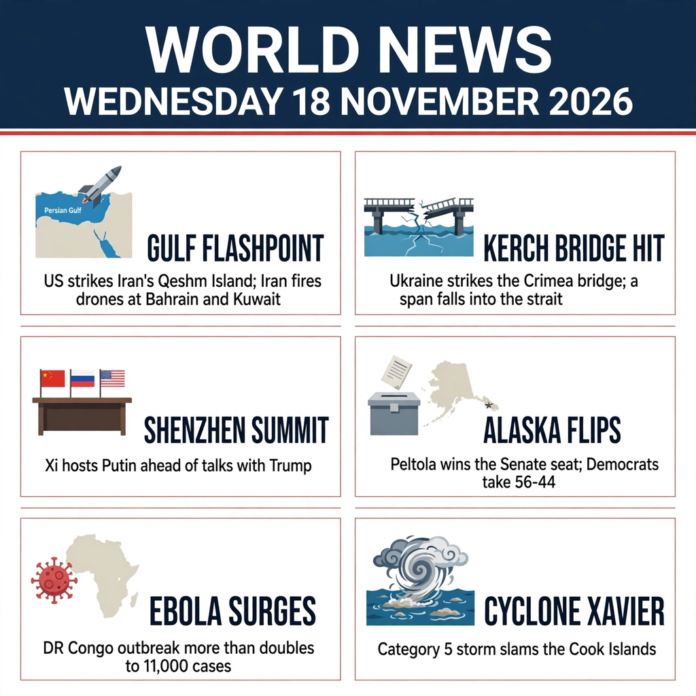

# World News — 18 November 2026

[](https://make.fun/bounty/news-image-20261118)
[](https://make.fun/bounty/news-image-20261118/leaderboard)
[](https://make.fun/bounty/news-image-20261118)

One image that sums up the world's news of **Wednesday 18 November 2026**, entered in the
[make.fun](https://make.fun) competition
[news-image-20261118](https://make.fun/bounty/news-image-20261118).



## The day in six stories

1. **Gulf flashpoint** — The US struck an Iranian missile site on Qeshm Island; Iran fired
   drones at Bahrain and Kuwait.
2. **Kerch Bridge hit** — Ukraine struck the bridge to Crimea for a second day; a span fell
   into the strait.
3. **Shenzhen summit** — Xi Jinping hosted Vladimir Putin ahead of trilateral talks with
   Donald Trump.
4. **Alaska flips** — Democrat Mary Peltola won the Senate seat; Democrats take a 56–44
   majority.
5. **Ebola surges** — The DR Congo outbreak more than doubled, to over 11,000 cases.
6. **Cyclone Xavier** — A Category 5 storm slammed the Cook Islands.

## How it runs

`main.py` (Python 3.13, standard library only) copies `entry.png` to
`/output/entry.png`. No network, fully deterministic — both runs write the same bytes.

```sh
mkdir -p out && MAKEFUN_OUTPUT_DIR=out python3 main.py
```
